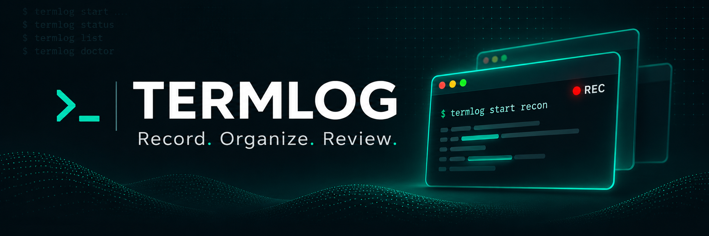
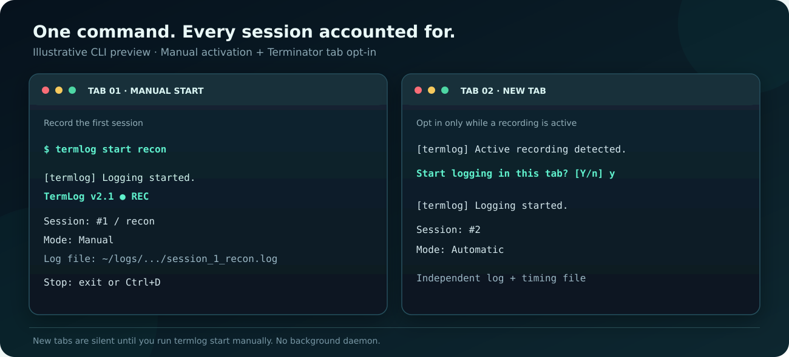
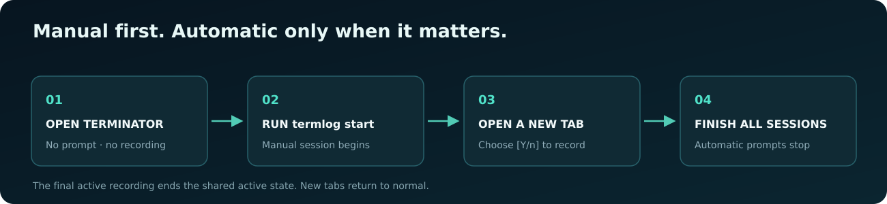

<div align="center">



<br />

**A lightweight, terminal-first session recorder built for pentesters, security researchers, and power users.**

*Record your work. Keep sessions separate. Find the evidence later.*

<br />


<br /><br />

[**Quick Start**](#quick-start) · [**Installation**](#installation) · [**Zsh Setup**](#zsh-setup) · [**Features**](#features) · [**CLI Reference**](#commands) · [**Security**](#security)

</div>

---

## ⚡ Why TermLog?

Pentests rarely happen in a single terminal. A recon tab, an enumeration tab, a quick verification, another window, another day and suddenly your evidence is scattered across shell history, scrollback, and loose text files.

**TermLog captures terminal sessions into dated, independently named logs, without making you opt in every time you open a terminal.** You decide when an engagement's recording begins. New Terminator tabs can then offer their own independent recordings while at least one session is active.


## 🎬 Preview



<sub>Illustrative example based on the v2.1 CLI, not a screenshot captured from a live pentest.</sub>

### How automatic activation works



| Without an active session | With an active session |
| :-- | :-- |
| 💤 Open tabs normally; **no prompt, no recording**. | 🔴 Open a new Terminator tab; TermLog asks **`[Y/n]`**. |
| 🖥️ You can still run `termlog start` manually. | ✅ Accept to record this tab independently, or decline and keep working normally. |

<a id="features"></a>
## ✨ Features

| | |
| :-- | :-- |
| 🎥 **Full terminal-session recording** — capture terminal output in a session log using Linux `script`. | 🗂️ **Daily organization** — logs grouped in `YYYY-MM-DD/`, with optional session labels. |
| 🧠 **Smart Terminator prompts** — prompts appear only while another TermLog recording is active. | 🧵 **Multiple independent tabs** — each accepted tab has a separate session ID, log, and timing data. |
| 🎨 **Clean CLI experience** — detailed or minimal startup banners, optional ANSI colors, and an end-of-session summary. | 🔎 **Inspect and diagnose** — `status`, `list`, `show`, `config`, and `doctor` commands. |
| 🧷 **Session lifecycle tracking** — shared state and locking prevent stale state from keeping auto-prompts alive. | 📦 **Log rotation** — compress older logs without compressing files still being recorded. |
| 🔐 **Private by default** — restrictive permissions for newly managed logs and state; no automatic upload. | 📴 **No persistent service** — the feature does not require a background daemon or systemd service. |

<a id="quick-start"></a>
## 🚀 Quick Start

Already installed and integrated with Zsh?

```bash
# Start the first recording manually
termlog start recon

# Work normally in the recorded shell
whoami
pwd

# Open another Terminator tab → answer the [Y/n] prompt
# Exit a recorded shell when finished
exit
```

When the **last active recording** closes, subsequent Terminator tabs will no longer show a logging prompt.

> **New here?** Follow the installation and Zsh integration steps below once. All defaults work without setting custom environment variables.

<a id="installation"></a>
## 📦 Installation

### Requirements

- **Linux** (the current backend uses util-linux `script`; macOS is not supported in v2.1).
- **Bash** to run the main `termlog` command.
- **Zsh** for optional automatic startup integration.
- **Terminator** for automatic tab/window prompts (`TERMINATOR_UUID` is used to detect it). Manual recording works outside Terminator when prerequisites are met.
- `script` from **util-linux**. `git` is needed for the clone-based installation below.

Check the basics:

```bash
command -v bash
command -v zsh
command -v script
command -v terminator
```

### 1. Clone the repository


```bash
git clone https://github.com/xbeatzsec/termlog.git "$HOME/.local/share/termlog"
```

### 2. Make the CLI available

```bash
mkdir -p "$HOME/.local/bin"
chmod +x "$HOME/.local/share/termlog/termlog"
ln -s "$HOME/.local/share/termlog/termlog" "$HOME/.local/bin/termlog"
```

This creates a symlink, so updating your checkout updates the CLI without copying the script again. If `~/.local/bin/termlog` already exists, inspect it before replacing it; don't overwrite another installation blindly.

<a id="zsh-setup"></a>
### 3. Enable automatic prompts in Zsh

Back up your Zsh configuration:

```bash
cp -p ~/.zshrc ~/.zshrc.backup-$(date +%Y%m%d-%H%M%S)
```

Add this block **near the end of `~/.zshrc`**, after your existing prompt or theme initialization:

```zsh
# ── TermLog ───────────────────────────────────────────────────────
export PATH="$HOME/.local/bin:$PATH"
if [[ -r "$HOME/.local/share/termlog/termlog.zsh" ]]; then
  source "$HOME/.local/share/termlog/termlog.zsh"
fi
# ─────────────────────────────────────────────────────────────────
```

Open a **new Terminator window** and validate the installation:

```bash
command -v termlog
termlog doctor
```

If no session is active, you should see **no automatic recording prompt** on startup. That is intentional.

**Already using another checkout?** Keep that directory if you prefer: link its `termlog` executable into a directory on `PATH`, then source the matching `termlog.zsh` with an absolute path in your `.zshrc`. You do not need to move your existing logs.

### 4. Start your first session

```bash
termlog start recon
```

Example output (format and paths vary by system):

```text
[termlog] Logging started.  TermLog v2.1  
[termlog] Session:    #1 / recon
[termlog] Started:    2026-11-15 21:00:00 UTC
[termlog] Mode:       Manual
[termlog] Log file:   /home/user/logs/2026-11-15/session_1_recon.log
[termlog] Stop:       exit or Ctrl+D
```

Now open a new Terminator tab. While this first recording is active, a new tab can ask:

```text
[termlog] Start logging in this tab? [Y/n]:
```

Press **Enter** or type **`y`** to start an independent recording. Type **`n`** to keep that tab unrecorded.

### Updating an existing clone

```bash
git -C "$HOME/.local/share/termlog" pull --ff-only
termlog doctor
```

Review release notes and back up your Zsh configuration before upgrading across major versions.

## 🛠️ Usage

### Start, check, and finish a session

```bash
termlog start web-recon   # Start a named session
termlog status            # Inspect recording status in this shell
termlog stop              # Explain how to exit the recorded shell
exit                      # End the current recorded shell
```

A **manually** started recording returns you to your previous shell after `exit`. A recording accepted during automatic Zsh startup closes its terminal tab when the recorded shell exits.

### Browse your recorded files

```bash
termlog list                   # List today's sessions
termlog list 2026-11-15        # List a specific day
termlog show session_1_recon.log
termlog rotate 7               # Compress older completed logs
```

`show` removes common terminal-control sequences for a more readable text view. Rich terminal applications may still need a dedicated terminal-aware renderer for faithful playback.

### Example log layout

```text
~/logs/
└── 2026-11-15/
    ├── session_1_recon.log
    ├── session_1_recon.timing
    ├── session_2_web-recon.log
    └── session_2_web-recon.timing
```

Log paths are configurable. Session numbers are assigned independently of the optional label, with protections for concurrent startups.

<a id="commands"></a>
## ⌨️ Command reference

| Command | Description |
| :-- | :-- |
| `termlog start [label]` | Start a recording manually. |
| `termlog stop` | Show how to end a recorded shell (`exit` / Ctrl+D). |
| `termlog status` | Show the current shell's recording status. |
| `termlog list [YYYY-MM-DD]` | List available sessions for a day. |
| `termlog show <file>` | Print a log with common ANSI sequences removed; supports compressed logs. |
| `termlog rotate [days]` | Compress older, completed logs. |
| `termlog doctor` | Check dependencies, directories, permissions, and integration. |
| `termlog config` | Display effective configuration. |
| `termlog disable` | Disable automatic startup handling in the current Zsh shell and its descendants. |
| `termlog enable` | Re-enable automatic startup handling for future descendants. |
| `termlog help` | Show help. |

> `disable` and `enable` are **shell-local** controls, not a global off switch. They don't stop an already running recording or disable prompts in unrelated tabs. The Zsh integration provides the shell-local behavior.

## ⚙️ Configuration

**No extra variables are required for the default experience.** The following are optional environment-based customizations; set them *before* the Zsh integration is loaded if you want non-default behavior.

| Variable | Values / example | Default |
| :-- | :-- | :-- |
| `TERMLOG_MODE` | `ask`, `auto`, `off` | `ask` |
| `TERMLOG_BANNER_STYLE` | `detailed`, `minimal`, `off` | `detailed` |
| `TERMLOG_COLOR` | `auto`, `always`, `never` | `auto` |
| `TERMLOG_TAB_TITLE` | `off`, `rec` | `off` |
| `TERMLOG_DIR` | Directory for log files | `~/logs` |
| `TERMLOG_ROTATE_DAYS` | Number of days | `7` |
| `TERMLOG_STATE_DIR` | Private runtime state directory | Managed by TermLog |

**Automatic modes never start the first session:**

- `ask` — ask in new Terminator tabs **only when a session is already active**.
- `auto` — automatically record eligible new tabs **only when a session is already active**.
- `off` — disable automatic tab startup while retaining manual `termlog start`.

For example, to use a compact banner in your current shell:

```bash
export TERMLOG_BANNER_STYLE=minimal
termlog start recon
```

To return to defaults, simply unset the override:

```bash
unset TERMLOG_BANNER_STYLE TERMLOG_COLOR TERMLOG_TAB_TITLE
```

`NO_COLOR` takes precedence over `TERMLOG_COLOR`. The optional tab-title indicator is experimental: themes may overwrite it, and the original tab title may not be restored exactly after a session.

<a id="security"></a>
## 🔐 Security notes

TermLog is designed to keep session files local and restrict access, **not** to make recordings secret-proof or tamper-proof.

- 🔒 New managed directories and files use restrictive permissions. Existing `~/logs` permissions may need attention; `termlog doctor` will tell you.
- 🧯 Terminal **output** can contain credentials, access tokens, hostnames, customer data, or other sensitive information. Review logs before sharing them.
- ⛔ The recorder does **not** enable stdin/input capture by default; do not assume that this makes every recorded session safe for secrets.
- 📁 Keep your recorded data on a trusted filesystem. Treat exported logs as sensitive engagement artifacts.
- ✅ Only collect activity you are authorized to perform and record. Follow your engagement's handling and retention rules.

If the directory permissions check fails:

```bash
chmod 700 "$HOME/logs"
termlog doctor
```

This changes permissions on the top-level logs directory only; it does not rewrite historical files.

## 🩺 Troubleshooting

<details>
<summary><strong>New Terminator tabs never ask to start logging</strong></summary>

The **first session must be started manually** with `termlog start`. Keep that recording open while opening the next tab. Verify that the Zsh integration is sourced and `termlog doctor` reports Terminator detection. Automatic startup is intentionally gated to the supported Terminator environment.

</details>

<details>
<summary><strong><code>termlog: command not found</code></strong></summary>

Make sure `$HOME/.local/bin` is in your `PATH`, the symlink exists, and the main script is executable. Open a new Zsh shell after editing `.zshrc`.

</details>

<details>
<summary><strong>TermLog reports excessive permissions on <code>~/logs</code></strong></summary>

Run `chmod 700 "$HOME/logs"`, then `termlog doctor` again. Review permissions of existing log files separately if needed.

</details>

<details>
<summary><strong>Recording title does not change or does not reset</strong></summary>

The `[REC]` tab title is an opt-in experimental feature (`TERMLOG_TAB_TITLE=rec`). Some Zsh themes control terminal titles, and an unexpected process exit may leave a stale indicator. Leave the feature disabled if it conflicts with your setup.

</details>

<details>
<summary><strong>I want the old behavior back</strong></summary>

Remove only the TermLog integration block from `.zshrc` and open a fresh terminal. Your recorded logs remain where they are. See [Uninstall / rollback](#rollback).

</details>

## 🧪 Development and testing

The v2.1 implementation includes a Python integration test suite with pseudoterminal coverage for manual/automatic sessions, prompts, concurrency, banners, colors, and state cleanup. The original v2.1 implementation report recorded **15 passing automated tests**. This is a historical implementation result, not a live CI status badge.

```bash
bash -n termlog
zsh -n termlog.zsh
```

Integration tests are located at `tests/test_integration.py`; use the test runner configured for your checkout. Real multi-tab Terminator behavior should also be validated manually after UI changes.

Contributions are welcome via issues and pull requests once the repository is published. Useful areas include robust terminal rendering, docs, packaging, and Linux compatibility.

## 🗺️ Ideas for the future

These are **not** part of v2.1:

- 🔍 Interactive session browser and cross-log search.
- 🔖 Bookmarks and private notes tied to recorded sessions.
- 🧾 Markdown/HTML evidence summaries.
- 🗃️ Project-based workspaces and evidence references.

The priority is to keep TermLog small, predictable, and safe to run during authorized testing.

<a id="rollback"></a>
## 🧹 Uninstall / rollback

Remove the TermLog block from `~/.zshrc`, then open a new shell. If you installed with the paths above, you can optionally remove the symlink and local checkout **after confirming their location**:

```bash
# Remove only if these paths belong to this TermLog installation
rm "$HOME/.local/bin/termlog"
rm -r "$HOME/.local/share/termlog"
```

> Recorded logs in `~/logs` are **not** removed by the commands above. Keep or dispose of them according to your engagement's data-retention requirements.

---

<div align="center">

### >_ Record the terminal. Keep the context.

**TermLog v2.1** · Linux · Bash + Zsh · Terminator

<sub>Built for transparent, local-first terminal recording during authorized security work.</sub>

</div>
